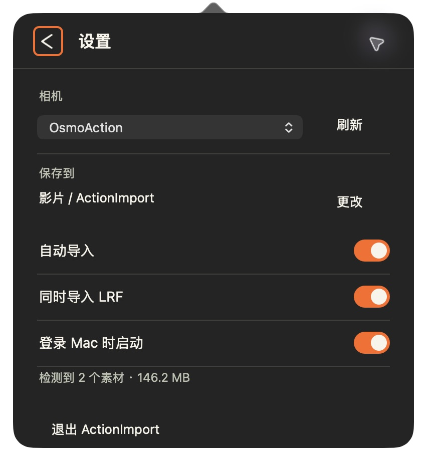

<p align="center">
  
</p>

<h1 align="center">ActionImport</h1>

<p align="center">
  插上相机，素材自己回家。<br>
  macOS 菜单栏工具：相机接入后，新增视频自动复制到本地目录，SHA-256 校验通过才算完成，原片一个字节都不动。
</p>

<p align="center">
  <a href="https://github.com/jry21223/ActionImport/releases/latest"><b>⬇ 下载最新版</b></a>
  &nbsp;·&nbsp; macOS 13+ &nbsp;·&nbsp; 原生 AppKit &nbsp;·&nbsp; 无第三方依赖
</p>

<p align="center">
  
  &nbsp;&nbsp;
  
</p>

## 特点

| | |
|---|---|
| **自动导入** | 已配置的相机一挂载就扫描并导入，菜单栏显示实时进度��完成后发通知 |
| **原片不动** | 只读打开相机文件，保存目录不能落在相机存储里 |
| **校验到位** | 边复制边算 SHA-256，读回目标再核对一次，一致才记为完成 |
| **再插秒过** | 已导入且未变化的文件凭清单记录跳过，不再整卡重读；需要时可手动完整核对 |
| **不丢不盖** | 同名不同内容保留两份；中断后只重做未完成的文件 |
| **按日归档** | 按拍摄日期分文件夹，保留原文件名；LRF 代理文件可选导入 |

> 已验证：DJI Osmo Action 6 + Apple Silicon Mac。其他相机型号尚未验证，欢迎反馈。

## 安装

1. 从 [Releases](https://github.com/jry21223/ActionImport/releases/latest) 下载 zip，解压后把 `ActionImport.app` 拖进“应用程序”。
2. 应用未经 Apple 公证，第一次打开会被拦截：
   - **macOS 15+**：关闭提示后，到“系统设置 → 隐私与安全性”底部点“仍要打开”。
   - **macOS 13–14**：右键点应用 → “打开”。
   - 或在终端执行 `xattr -dr com.apple.quarantine /Applications/ActionImport.app`。
3. 在设置页选择相机和保存目录，打开“自动导入”。之后相机接入时，在相机上选择“传输文件”即可。

左键点菜单栏图标展开面板，右键可以立即导入、完整核对、打开目录和退出。

## 工作原理


<details>
<summary>更多细节</summary>

- 日期优先取自 DJI 文件名，无法识别时使用文件修改日期。
- 归档目录里的 `.actionimport-manifest.json` 记录已核验文件；隐藏的 `.partial` 文件不代表导入完成。
- 再次接入时，来源的路径、大小、修改时间和归档文件元数据都没变，就直接跳过。需要逐字节确认时，用右键菜单“完整核对已导入素材”，或命令行 `--full-verify`。
- 同一保存目录同一时间只允许一个导入任务。

</details>

## 从源码构建

需要 Swift 6 工具链（Xcode 或 Command Line Tools）。

```sh
git clone https://github.com/jry21223/ActionImport.git
cd ActionImport
zsh scripts/build-app.sh      # 输出 dist/ActionImport.app
swift run ActionImportChecks  # 17 项 fixture 检查，只用临时文件
zsh scripts/release.sh        # 带版本号的 zip + SHA-256
```

后台空闲时内存约 34 MiB，平均 CPU 约 0.016% 单核心，测量方法见 [性能说明](docs/performance/README.md)。术语见 [GLOSSARY](GLOSSARY.md)。

## 后续方向

计划加入本地 AI 素材初筛（内容标签、待复核提示），只分析已校验的电脑副本，不删除原片。目前仅完成调研：[产品调研](docs/research/ai-local-footage-products.md) · [开源项目调研](docs/research/ai-local-footage-github.md)。
