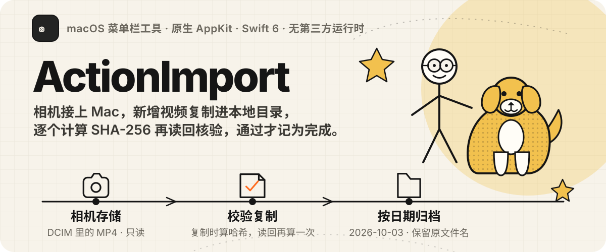
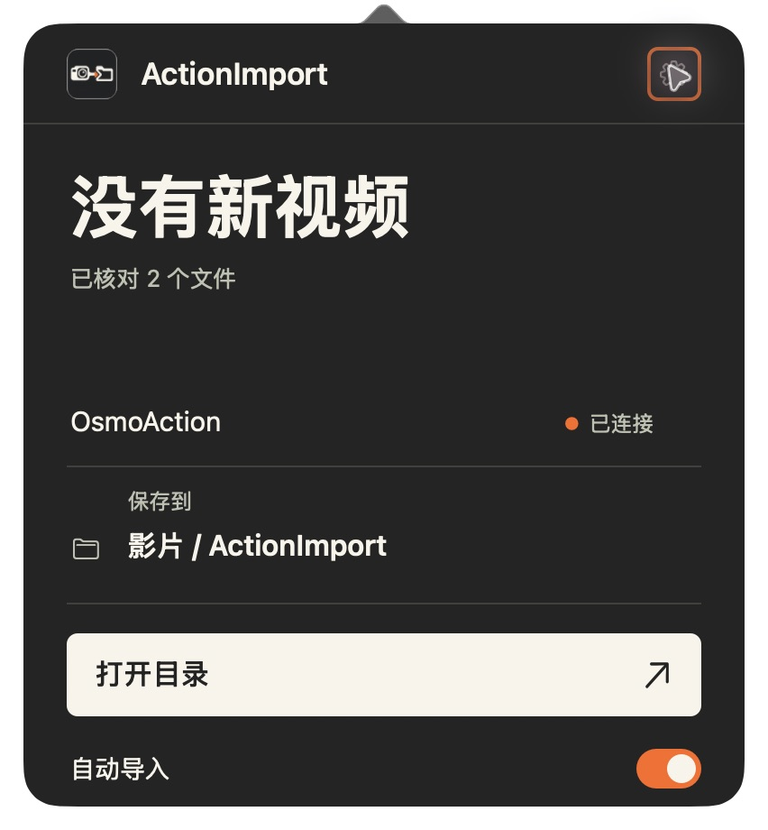
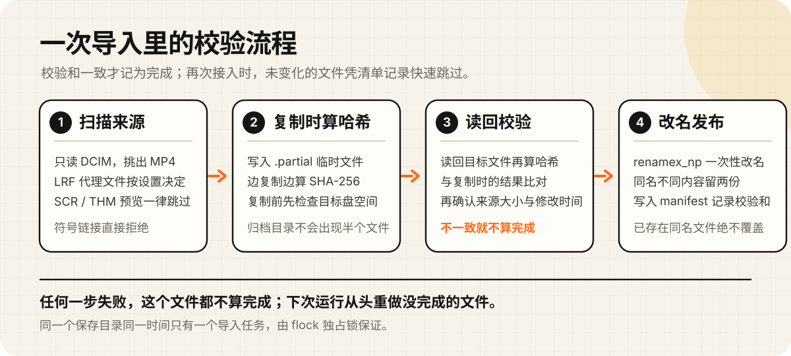

# ActionImport



轻量的 macOS 菜单栏工具。相机接入后，将新增视频导入你选择的本地目录，完成 SHA-256 校验后保留归档；相机原片保持不变。

当前围绕 DJI Osmo Action 6 的 USB 文件传输模式开发，使用原生 AppKit，没有第三方运行时。



## 已实现

- 选择相机与保存目录，按卷 UUID 识别已配置设备。
- 相机挂载时自动扫描并导入，也可以手动开始、停止或重试。
- 默认导入 MP4，可开启 LRF 代理文件导入；忽略 SCR/THM 预览图。
- 按拍摄日期归档，保留原文件名。
- 复制流计算 SHA-256，再读取目标核验；重复接入时未变化的文件凭清单快速跳过，可手动完整核对。
- 同名不同内容保留两份，文件级恢复，并发导入保护。
- 菜单栏状态、真实进度、错误提示、原生设置页与可选登录启动。

## 下载使用

已验证环境：DJI Osmo Action 6 + Apple Silicon Mac，macOS 13 或更高版本。其他相机型号尚未验证。

1. 在 [Releases](https://github.com/jry21223/ActionImport/releases) 下载 `ActionImport-<版本>-macOS.zip`，解压后把 `ActionImport.app` 拖进“应用程序”。
2. 应用使用 ad-hoc 签名，没有经过 Apple 公证，第一次打开会被 macOS 拦截：
   - macOS 15 及以上：双击后关闭提示，打开“系统设置 → 隐私与安全性”，在页面底部点“仍要打开”。
   - macOS 13–14：在“应用程序”里右键点应用，选“打开”，再在弹窗中点“打开”。
   - 也可以在终端执行 `xattr -dr com.apple.quarantine /Applications/ActionImport.app`，去掉下载隔离标记。
3. 可选：用同一页面的 `.sha256` 文件核对下载内容，执行 `shasum -a 256 -c ActionImport-<版本>-macOS.zip.sha256`。

## 从源码构建

需要 macOS 13 或更高版本，以及 Swift 6 工具链（Xcode 或 Command Line Tools）。目前真机验收来自 Apple Silicon Mac 和 Action 6，其他相机型号尚未验证。

```sh
git clone https://github.com/jry21223/ActionImport.git
cd ActionImport
zsh scripts/build-app.sh
```

构建产物为 `dist/ActionImport.app` 和 `dist/ActionImport-macOS.zip`；`zsh scripts/release.sh` 会另外生成带版本号的 zip 和 SHA-256 文件，并打印发布命令。将应用放入“应用程序”后打开，在设置页选择相机和保存目录，并按需开启自动导入、LRF 和登录启动。相机接入时，仍需在相机上选择“传输文件”。构建使用本地 ad-hoc 签名，当前未提供公证发行版。

左键点击菜单栏图标展开主面板，齿轮进入设置；右键提供立即导入、完整核对、打开目录和退出。已配置的应用在后台启动，收起面板后继续常驻。

日期优先取自 DJI 文件名，无法识别时使用文件修改日期。中断的大文件下次从头复制，已完成且校验一致的文件跳过。重复接入时，清单记录的来源路径、大小、修改时间与归档文件元数据都没变化，就直接跳过，不重新读取；需要逐字节确认时，用右键菜单的“完整核对已导入素材”，或命令行 `--full-verify`。归档目录的 `.actionimport-manifest.json` 记录已核验文件；隐藏的 `.partial` 文件不代表导入完成。

## 校验流程



## 验证与性能

```sh
swift run ActionImportChecks
```

17 项检查覆盖复制与来源保留、去重、同名冲突、取消恢复、损坏目标恢复、来源路径保护、LRF 选项、空间不足、并发任务、快速跳过与完整核对，以及日期归档和面板状态。检查使用临时文件，不使用用户原片。

原生 C 面板使用后，后台空闲 120 秒 footprint 为 **33.77–33.83 MiB**，平均 CPU **0.015535% / 单核心**。这是空闲窗口，不是完整导入峰值或长期泄漏测试。方法、原始采样和限制见 [性能说明](docs/performance/README.md)。

[设置页截图](design-demos/native-c-settings.jpg) · [术语](GLOSSARY.md)

## 后续方向

本地 AI 素材初筛与分类目前仅完成研究，尚未接入模型。计划评估内容标签和待复核提示，分析已校验的电脑副本，不自动删除原片。

- [产品与原生 Mac 组件调查](docs/research/ai-local-footage-products.md)
- [开源视频项目与许可证调查](docs/research/ai-local-footage-github.md)

研究记录保留调查日期，不代表候选项目当前状态或实测效果。
